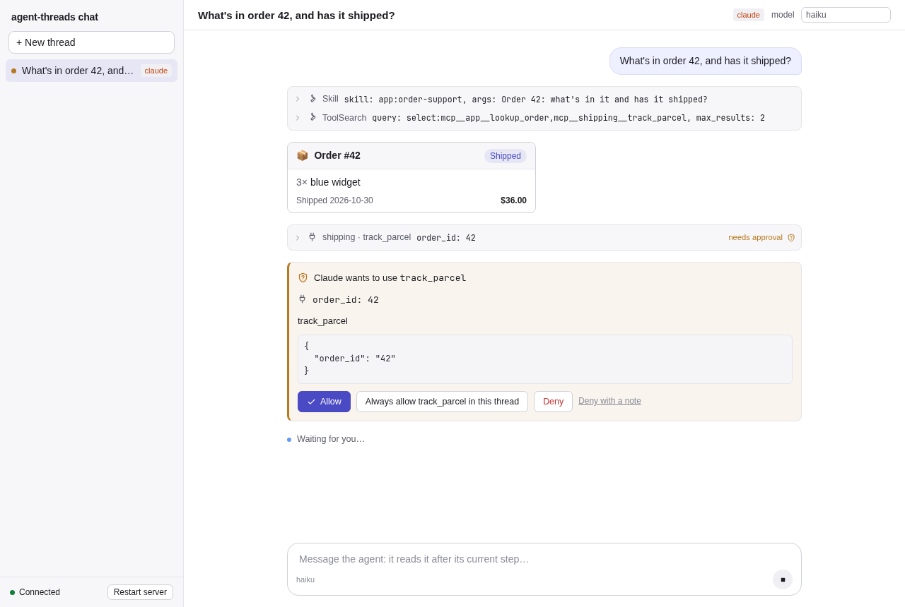
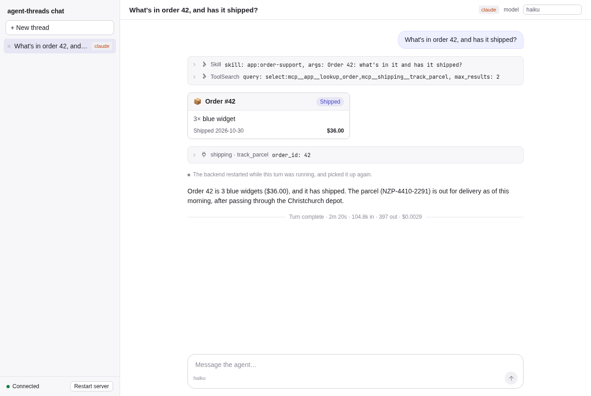

# chat-node: an example chat app

A small support-chat app on agent-threads: a Node server running
[@dire-kiwi/agent-threads-node](../../ts/packages/node/README.md), and a Vite + React frontend drawn
with [@dire-kiwi/agent-threads-react](../../ts/packages/react/README.md). The SDK has no network
layer, so the app brings its own, a WebSocket. That is the point of the example: it shows the "bring
your own network" seam from end to end.



It has, as a real app would:

- **Threads on Claude Code or Codex**, picked per thread, listed in a sidebar, kept in SQLite
  (`SqliteStore`) and resumed after a restart.
- **An app tool**, `lookup_order` ([server/orders.ts](server/orders.ts)), which the backend runs in
  process. Its structured output is drawn by a **custom renderer**, an order card
  ([web/src/OrderCard.tsx](web/src/OrderCard.tsx)).
- **An external MCP server**, `shipping` ([server/shipping-mcp.ts](server/shipping-mcp.ts)), a
  stdio server with `track_parcel`, which the harness starts.
- **A skill**, [skills/order-support](skills/order-support/SKILL.md), saying how to answer
  questions about orders.
- **A permission policy** ([server/policy.ts](server/policy.ts)) that allows what only reads and
  asks the user about everything else (the MCP tool, edits, other commands).
- **Runs that outlive the server**, optionally: with `CHAT_SHIM` the harnesses run under
  `agent-threads-shim`, and the **Restart server** button shows a turn carrying on across a
  restart.

## Running it

You need what the repository needs (Node 24+, pnpm 10), and `claude` and/or `codex` installed and
logged in. Threads see only the app's tools, MCP server and skill, not your own config. Claude
Code threads use `haiku` by default and Codex threads `gpt-5.6-luna` at low effort, so trying it
out costs a cent or so per question.

```sh
cd ts && pnpm install && pnpm build   # the SDK's packages (and this app's frontend)
cd ../examples/chat-node
pnpm dev                              # the server on :3001, and Vite on http://localhost:5173
```

Or, with the frontend built, `pnpm start` serves it and the WebSocket on http://127.0.0.1:3001.

Ask about orders 42, 7, 1001 or 1002, e.g. "Where's the parcel for order 1001 now?" The agent
loads the skill, looks the order up (an order card) and asks to track the parcel (a permission
card). Ask it to write a file to see an edit asking first.

| Variable | |
| --- | --- |
| `PORT` | The port, 3001 by default (on 127.0.0.1). |
| `CHAT_DATA` | Where the threads (`threads.db`), the shim's runs, Codex's home and the agents' working directory go: `./data` by default. |
| `CHAT_HARNESSES` | The harnesses to offer: `claude,codex` by default. |
| `CHAT_CLAUDE_MODEL`, `CHAT_CODEX_MODEL`, `CHAT_CODEX_EFFORT` | The defaults for new threads (`haiku`, `gpt-5.6-luna`, `low`). The model can be changed per thread. |
| `CHAT_SHIM` | Run the harnesses under `agent-threads-shim`: `1` for the one `make shim` builds, or a path to the binary. |
| `CHAT_FAKE_CLAUDE`, `CHAT_FAKE_CODEX` | Replay a recorded session (a `spec/fixtures/...` directory) with the fake CLI instead of the real one: no login, no cost. The tests use this. |

### The restart demo

```sh
make shim                             # from the repository's root
CHAT_SHIM=1 pnpm dev
```

Ask something that needs a permission (tracking a parcel), and while the card waits, click
**Restart server**. The server shuts down without stopping its runs, and `supervise.ts` starts it
again. On startup, `sdk.recover()` re-attaches to the run, and the frontend reconnects and takes a
fresh snapshot. The thread says it was picked up again, and the same permission can still be
answered, so the turn finishes. You can also restart it yourself (Ctrl-C, then `pnpm dev` again).
Without `CHAT_SHIM`, a turn that's running when the server stops is lost, and ends with a `run.lost`
notice.



## The seam: events out, commands in

Everything between the SDK and the browser is in [server/main.ts](server/main.ts) and
[web/src/App.tsx](web/src/App.tsx). The wire format, which the Go and Rust examples' servers speak
too, is in [../PROTOCOL.md](../PROTOCOL.md).

**Events out.** The backend calls one subscriber with every thread's events, deltas included. The
server sends them to every client:

```ts
sdk.subscribe((event) => {
  const frame = JSON.stringify({ type: "event", event });
  for (const ws of clients) ws.send(frame);
});
```

**Commands in.** The React components make the protocol's commands (`send`, `interrupt`,
`respond`, `set_options`) and give them to the app's `onCommand`. The frontend sends them over the
socket, and the server hands them to `sdk.handle`, which checks them against the schema and
throws a `CommandError` for one it can't carry out. The frontend shows that as the component's
error:

```ts
// web/src/App.tsx
const onCommand = (command: Command) => conn.call("command", { command });
// server/main.ts
command: async ({ command }) => { await sdk.handle(command); return null; },
```

**Catching up.** A client that opens a thread takes `sdk.snapshot(id)` and makes a `ThreadSource`
from it: the snapshot, the thread's events from the socket, and `resync`, which fetches
`sdk.eventsSince(id, seq)`. The React store calls `resync` when it connects, for what came between
the snapshot and subscribing, and whenever a saved event's `seq` skips ahead. When the socket
reconnects, the client takes a fresh snapshot, which has any text streamed so far, and a new
source:

```tsx
const source: ThreadSource = {
  snapshot,
  subscribe: (fn) => conn.onEvent((e) => e.thread_id === id && fn(e)),
  resync: (seq) => conn.call("events_since", { thread_id: id, seq }),
};
<ThreadProvider source={source} onCommand={onCommand} tools={{ lookup_order: { Row: OrderCard, alone: true } }}>
  <Thread />
</ThreadProvider>
```

The rest is the app's own: creating and listing threads (`sdk.create`, `sdk.list`, with the
sidebar kept up to date from `thread.updated` events), the harness picker, and the restart button.

## Tests

```sh
pnpm test                             # type-checks the server and the frontend
pnpm test:e2e                         # builds the frontend, and runs the Playwright smoke tests
```

The smoke tests ([e2e/chat.spec.ts](e2e/chat.spec.ts)) start the server with the fake CLI replaying
recorded sessions from `spec/fixtures` (which also checks that the backend sends the CLI what the
recording has), and drive the app in Chromium:

- the app tool's order card, on Claude Code and on Codex, and a reload starting again from a snapshot;
- a Codex command asking first, and the user allowing it;
- the server going away and coming back, the client reconnecting, and the thread resuming its session;
- with the shim (built by `make shim`, or the test is skipped), a turn waiting on a permission
  outliving a server restart.

They need Playwright's Chromium (`pnpm exec playwright install chromium`), or set `CHAT_E2E_BROWSER`
to the path of a Chromium or Chrome of your own.

## Files

| Path | What |
| --- | --- |
| `server/main.ts` | The backend and the WebSocket: the seam |
| `server/config.ts` | The environment variables |
| `server/orders.ts` | The `lookup_order` tool, and its orders |
| `server/policy.ts` | The permission policy |
| `server/shipping-mcp.ts` | The external MCP server |
| `server/static.ts` | Serves `web/dist` |
| `server/supervise.ts`, `server/dev.ts` | `pnpm start` (restarting the server when asked) and `pnpm dev` (that, and Vite) |
| `skills/order-support/` | The skill |
| `web/src/connection.ts` | The frontend's WebSocket, with requests, pushed events and reconnecting |
| `web/src/App.tsx` | The thread list, the new-thread form, and the open thread |
| `web/src/OrderCard.tsx` | The renderer for `lookup_order` |
| `e2e/` | The Playwright smoke tests |
